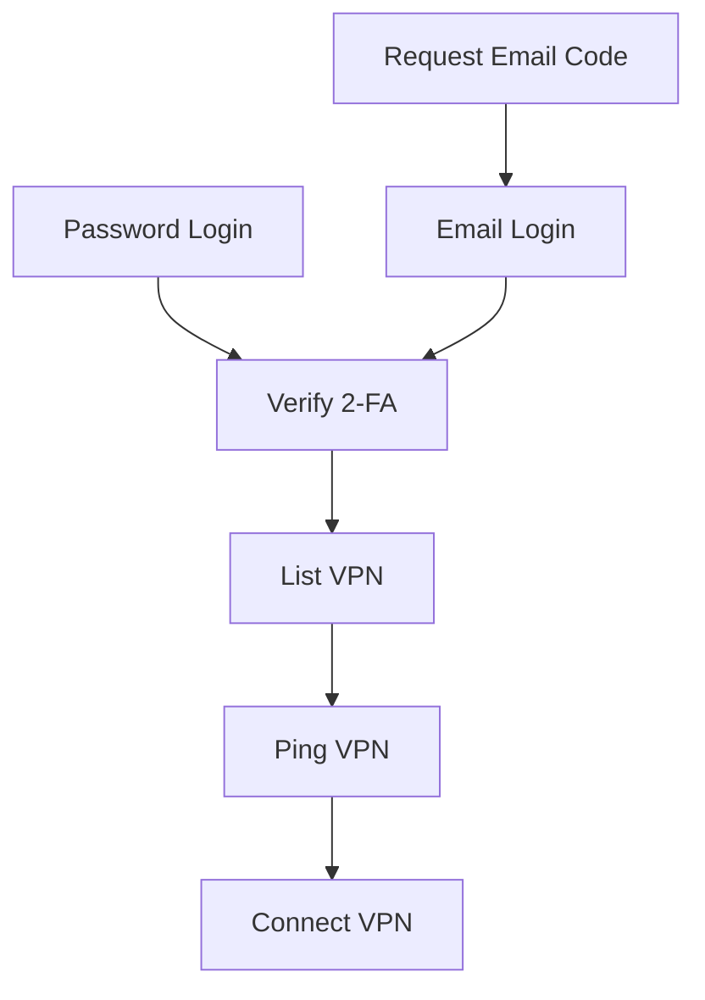
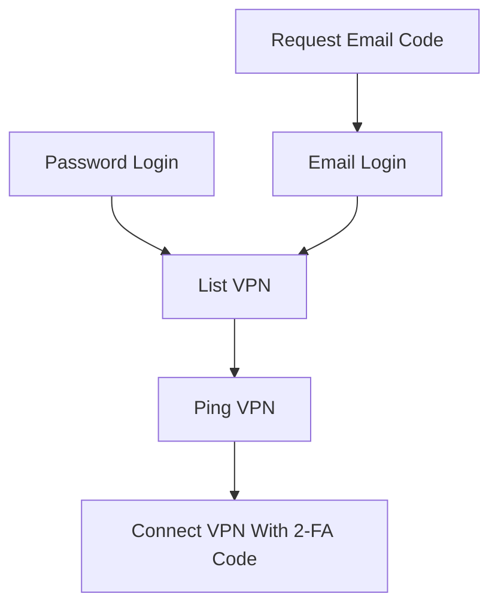

# corplink-rs

使用 rust 实现的 [飞连][1] 客户端，支持 Linux/Windows10/MacOS

# 安装

## ArchLinux

下载 [release](https://github.com/PinkD/corplink-rs/releases) 中的安装包，并安装

```bash
pacman -U corplink-rs-4.1-1-x86_64.pkg.tar.zst
```

> 欢迎贡献其它包管理器的打包脚本

## 手动编译

### linux/macos

```bash
git clone https://github.com/PinkD/corplink-rs --depth 1
cd corplink-rs
# build libwg
cd libwg
./build.sh
# if you are using Windows, you can clone and build libwg maunally
# ref: wireguard-go/Makefile:libwg

cargo build --release
# install corplink-rs to your PATH
mv target/release/corplink-rs /usr/bin/
```

### windows

**前提**: 需要 Go (≥1.22)、GCC (MinGW-w64)、make、Rust (GNU 工具链)。

安装工具链后，在 **PowerShell** 中执行：

```powershell
# 1. 构建 libwg（生成 libwg.a + libwg.h）
cd libwg
.\build.ps1

# 2. 构建 Rust 项目
cd ..
rustup toolchain install stable-gnu
rustup default stable-x86_64-pc-windows-gnu
cargo build --release
```

> 编译的 `build.ps1` 会调用 `make libwg`，该目标会以 `CGO_ENABLED=1` 编译 Go 代码。
> MinGW GCC 需要在 PATH 中，且 make 需要支持 bash 风格环境变量语法。
> 也可在 MSYS2 UCRT64 环境中执行 `./build.sh`（同样需要 Go + GCC）。

# 用法

> **该程序需要 root 权限来启动 `wg-go` (windows 上需要管理员权限)**

```bash
# direct: reads ~/.config/corplink-rs/config.json
corplink-rs
# or any other config file
corplink-rs /path/to/config.json   # same as: corplink-rs --config /path/to/config.json
# systemd
# config is /etc/corplink/config.json
systemctl start corplink-rs.service
# auto start
systemctl enable corplink-rs.service

# systemd with custom config
# config is /etc/corplink/test.json
# NOTE: cookies.json is reserved by cookie storage
systemctl start corplink-rs@test.service
```

不带参数时读取 `~/.config/corplink-rs/config.json`；用 `sudo` 运行时（包括程序自己通过 sudo 提权重新运行）用的是执行 sudo 的那个用户的目录，而不是 root 的。cookie 保存在配置文件所在目录（`<interface_name>_cookies.json`），所以默认情况下全部状态都在 `~/.config/corplink-rs/` 里。首次使用：

```bash
mkdir -p ~/.config/corplink-rs && chmod 700 ~/.config/corplink-rs
cp config/config.json ~/.config/corplink-rs/ && chmod 600 ~/.config/corplink-rs/config.json
# 然后编辑 ~/.config/corplink-rs/config.json，见下方配置文件实例
```

## windows 使用说明

### 快速开始（推荐使用预编译版本）

1. 从 [Releases](https://github.com/PinkD/corplink-rs/releases) 下载 `corplink-rs-*-windows.zip`
2. 解压到任意目录
3. 运行 `setup.ps1` 自动获取 `wintun.dll`：

```powershell
powershell -ExecutionPolicy Bypass -File setup.ps1
```

4. 编辑 `config.json`，填入公司代码和登录信息（见下方配置文件实例）
5. 以**管理员身份**打开 PowerShell，运行：

```powershell
.\corplink-rs.exe config.json

# 调试模式
$env:RUST_LOG="debug"; .\corplink-rs.exe config.json
```

### wintun.dll 说明

`corplink-rs` 依赖 [Wintun][6] 虚拟网卡驱动来创建 WireGuard 隧道。由于 Wintun 的许可证要求用户从[官网][6]直接获取，我们无法在 release 包中附带该文件。

`setup.ps1` 脚本会自动从 `wintun.net` 下载并解压 `amd64` 版本的 `wintun.dll` 到当前目录。

手动获取：访问 [wintun.net][6]，下载 zip 包，将 `bin/amd64/wintun.dll` 复制到 `corplink-rs.exe` 所在目录。

### 管理员权限

程序需要管理员权限，原因：
- `wg-go` 需要创建 TUN 虚拟网卡
- 配置系统路由表（自动添加 VPN 路由）

如果运行时提示 `please run as administrator`，右键 PowerShell 选择"以管理员身份运行"。

### 常见问题

- **wintun.dll 找不到**：运行 `setup.ps1` 或手动下载放入同目录
- **配置文件 JSON 不支持注释**：示例中的 `// comment` 需要删除
- **路由未生效**：检查是否以管理员运行，关闭其他 VPN 软件避免路由冲突

## macos 特殊说明

macos 要求 tun 设备的名称满足正则表达式 `utun[0-9]*` ，因此需要将配置文件中的 `interface_name` 改为符合正则的名字，例如 `utun12345`  
另外， `utun` 后的数字类型应该是 `int16` ，如果大于 `32767` 会报错 `Failed to create TUN device: invalid argument` 。具体参考 [#46](https://github.com/PinkD/corplink-rs/issues/46)

### macOS：用 App 安装（不需要命令行）

1. 打开 `corplink-gui-<version>.dmg`，把 Corplink GUI 拖进「应用程序」。
2. 从「应用程序」打开它。App 没有 Apple 开发者证书签名，第一次打开会被拦下：到「系统设置 → 隐私与安全性」点「仍要打开」。
3. 自动弹出「首次设置」：填写企业代码、用户名，按需填写密码、选择登录方式，点「验证并安装」，再在系统弹窗里输入管理员密码。
4. 需要扫码或输入验证码时会弹出登录窗口；连上后菜单栏图标变绿。

App 内置了守护进程和下文的安装脚本：配置写在 `~/.config/corplink-rs/config.json`，和命令行方式默认的是同一个文件；装的也是同一个 launchd 服务，两种方式可以混用，命令行装的服务 App 能直接管理，App 装的也能用脚本重装或卸载。之后的「设置」（账号、固定节点、分流域名）「重新安装服务」「卸载服务」「登录时启动 GUI」都在菜单的「服务」里；保存设置不需要管理员密码，服务会自动重启并读取新配置。设置里会逐条列出服务端下发的分流域名，标明哪些已在列表、哪些已被上级域名覆盖、哪些不能用，勾选后导入：`*.example.com` 这样的通配按 `example.com` 处理（macOS 的 resolver 文件本身就覆盖所有子域名），导入后保存才生效。路由等其他高级选项直接编辑配置文件。

构建 DMG（App 只支持构建它的那台 Mac 的架构，在 Apple Silicon 上构建就只能在 Apple Silicon 上用）：

```bash
./scripts/build-gui-dmg.sh   # 产物在 dist/corplink-gui-<version>.dmg
```

### macOS 后台服务（launchd，命令行安装）

LaunchDaemon 没有交互终端。如果配置中的认证信息可以自动完成登录，可以直接安装；如果首次登录需要扫码或输入验证码，可以装好后在菜单栏 GUI 里完成登录，或者先在前台完成登录，看到 VPN 已连接后按 `Ctrl+C` 退出：

```bash
./libwg/build.sh
cargo build --release

# 仅在首次登录需要交互、又不用 GUI 时执行
sudo ./target/release/corplink-rs
```

如果每次连接都要输入 2FA 验证码（服务端没有下发 TOTP 密钥，配置里没有 `code`），后台服务只能靠 GUI 在每次连接时输入。

然后安装并立即启动后台服务（不传 `--config` 时使用执行 sudo 的用户的 `~/.config/corplink-rs/config.json`）：

```bash
sudo ./scripts/install-launchd.sh \
  --binary "$PWD/target/release/corplink-rs" \
  --vpn-server Node03 \
  --log-filter corplink_rs=debug
```

安装脚本会完成以下操作：

1. 将 `target/release/corplink-rs` 复制到 `/usr/local/bin/corplink-rs`。
2. 根据配置文件的绝对路径生成 `/Library/LaunchDaemons/com.github.pinkd.corplink-rs.plist`。
3. 执行 `launchctl bootstrap` 并启动一个 corplink-rs 实例。
4. 核对进程属于该 LaunchDaemon；失败时恢复安装前的二进制和服务。

plist 设置了 `RunAtLoad`，因此以后开机时会自动启动。已经安装但当前未加载时，使用下面的命令启动：

```bash
sudo launchctl bootstrap system /Library/LaunchDaemons/com.github.pinkd.corplink-rs.plist
```

脚本不会复制或修改配置文件，只把它的绝对路径传给程序，cookie 保存在配置文件所在目录，因此安装后不要移动配置文件。之前用仓库目录里 `config.json` 安装的服务照常工作；想换到默认目录，把 `config.json` 和 `<interface_name>_cookies.json` 移到 `~/.config/corplink-rs/` 后执行 `sudo ./scripts/install-launchd.sh --config ~/.config/corplink-rs/config.json`。配置文件不要放在 `~/Desktop`、`~/Documents`、`~/Downloads`、iCloud、`~/Library/CloudStorage` 或外接卷上，LaunchDaemon 没有完全磁盘访问权限时读不到这些位置。

服务以 root 身份读取配置和保存 cookie，应限制这些文件的读取权限，并且只允许可信管理员修改配置目录。程序拒绝使用符号链接形式的配置文件，也不会通过符号链接回写 cookie。

更新源码后，使用相同流程重编并重装。安装脚本会优雅停止旧服务、替换 `/usr/local/bin/corplink-rs` 和 plist，再启动一个新实例；失败时会恢复旧二进制和服务。重装时没有传入的 `--config`、`--vpn-server`、`--log-filter` 沿用已安装的值，`--vpn-server ''` 可以取消指定节点：

```bash
git pull
./libwg/build.sh
cargo build --release
sudo ./scripts/install-launchd.sh
```

登录态失效后，服务进入「需要登录」状态等待，用菜单栏 GUI 的登录窗口完成扫码或验证码即可。不用 GUI 时（日志中出现 `no interactive UI available`），需要先停止服务，用服务所用的配置文件在前台重新登录，再启动服务：

```bash
plist=/Library/LaunchDaemons/com.github.pinkd.corplink-rs.plist
sudo launchctl bootout system/com.github.pinkd.corplink-rs
sudo /usr/local/bin/corplink-rs "$(plutil -extract ProgramArguments.1 raw "$plist")"   # 登录并看到 VPN 已连接后按 Ctrl+C
sudo launchctl bootstrap system "$plist"
```

状态、日志、重启和卸载：

```bash
# status
sudo launchctl print system/com.github.pinkd.corplink-rs
pgrep -fl corplink-rs

# logs
sudo tail -f /var/log/corplink-rs.err.log /var/log/corplink-rs.log

# restart
sudo launchctl bootout system/com.github.pinkd.corplink-rs
sudo launchctl bootstrap system /Library/LaunchDaemons/com.github.pinkd.corplink-rs.plist

# stop and uninstall (config, cookies, and logs are preserved)
sudo ./scripts/uninstall-launchd.sh
```

LaunchDaemon 本身以 root 身份运行，plist 的 `ProgramArguments` 中不应再加入 `sudo`。服务会在开机时启动，并在进程异常退出（包括握手超时，以及启动后 5 分钟内一直没有握手成功）后重新拉起；如果进程频繁退出，启动频率会被限制为最多每 60 秒一次。

### macOS 菜单栏图形界面（corplink-gui）

菜单栏控制器（类似 ClashX 的形态）：状态栏常驻一个白色挂锁图标，锁体按连接状态填充颜色（空心=未连接或服务未安装、橙=连接中、绿=已连接、红=需要登录），点开菜单可以连接/断开/重连、按延迟切换节点、弹出登录窗口（扫码/验证码，不再需要停服务进终端）、查看实时日志，「服务」子菜单管理安装和账号（见上文「用 App 安装」）。退出 GUI 不影响 VPN。

GUI 通过 `/var/run/corplink-rs.sock`（可用 `CORPLINK_IPC_SOCK` 覆盖）与守护进程通信，连接只接受 root 和配置文件属主，多用户机器上其他用户无法操控或读取日志。

只构建二进制（调试用，不经 .app 启动会在 Dock 出现图标，也没有内置服务可装）：`cargo build -p corplink-gui`。

0.6.0 起守护进程是常驻进程：GUI 连接过一次后，断开 VPN 只回到 Idle 而不退出进程（launchd 的 KeepAlive 不会拉起干净退出的进程）；握手超时在进程内直接重连，跳过 launchd 的重启节流；连接失败按 10s 起翻倍的间隔自动重试 5 次，仍失败则停在 Idle，等你从菜单重新连接。登录态过期、需要扫码或输入验证码时进入"需要登录"状态安静等待 GUI，而不是每 60 秒重启一次（邮箱验证码登录也不会在没人能输入时先发出验证码）；登录提示 10 分钟无人应答同样回到"需要登录"，不会自动重试。从未有 GUI 连接过时，其余行为与旧版一致：连接失败或握手超时都会退出交给 launchd 拉起。

GUI 只支持 macOS：Linux/Windows 上守护进程不创建 socket，行为与旧版完全一致（需要登录时直接报错退出，交给 systemd 等处理）。socks5/netstack 模式下 libwg 无法在同一进程内重启隧道，因此隧道起来后 GUI 的连接/断开/切换节点会被拒绝，握手超时仍然退出进程，需要重启 corplink-rs。

## log level 配置

本项目使用 [env_logger](https://docs.rs/env_logger/latest/env_logger/) 作为 log 库，修改 log level 需要使用环境变量，示例：

```bash
RUST_LOG=debug ./corplink-rs config.json
```

# 配置文件实例

配置文件默认是 `~/.config/corplink-rs/config.json`。JSON 不支持注释，下方完整配置里的注释需要删掉。

最小配置

```json
{
  "company_name": "company code name",
  "username": "your_name"
}
```

推荐配置(自用配置)

```json
{
  "company_name": "company code name",
  "username": "your_name",
  "password": "your_pass",
  "platform": "ldap"
}
```

完整配置

```json
{
  "company_name": "company code name",
  "username": "your_name",
  // support sha256sum hashed pass if you don't use ldap, will ask email for code if not provided
  "password": "your_pass",
  // default is feilian, can be feilian/ldap/lark(aka feishu)/OIDC
  // dingtalk/aad/weixin is not supported yet
  "platform": "ldap",
  "code": "totp code",
  // default is DollarOS(not CentOS)
  "device_name": "any string to describe your device",
  "device_id": "md5 of device_name or any string with same format",
  "public_key": "wg public key, can be generated from private key",
  "private_key": "wg private key",
  "server": "server link",
  // enable wg-go log to debug uapi problems
  "debug_wg": true,
  // will use corplink as interface name
  "interface_name": "corplink",
  // will use the specified server to connect, for example 'HK-1'
  // name from server list
  "vpn_server_name": "hk",
  // latency/default
  // latency: choose the server with the lowest latency
  // default: choose the first available server
  "vpn_select_strategy": "latency",
  // use vpn dns (macOS: networksetup; Linux: rename /etc/resolv.conf aside
  //   and write a new one with the VPN-provided nameserver)
  // NOTE: if process doesn't exit gracefully, your dns may not be restored
  "use_vpn_dns": false,
  // macOS only: per-domain split DNS. on every connect the daemon writes
  // /etc/resolver/<domain> files pointing at the DNS assigned for that
  // session (it can change between sessions) and removes them on shutdown,
  // so intranet domains resolve via the VPN without touching system-wide
  // DNS settings. include CNAME target domains: macOS resolves the follow-up
  // query with the resolver matching the target domain, which falls back to
  // the default DNS if it is not listed.
  // existing /etc/resolver files not written by corplink-rs are left alone.
  // needs interface_name of the form utunN, e.g. utun12345
  // NOTE: if process doesn't exit gracefully, the files are removed on the
  //   next start; if you stop using corplink-rs after a crash, delete the
  //   /etc/resolver files starting with "# managed by corplink-rs" with sudo
  "split_dns_domains": ["intranet.example.com", "cname-target.internal.example"],
  // optional: filename for the Linux backup of /etc/resolv.conf.
  // Default "resolv.conf.corplink", always placed next to /etc/resolv.conf.
  // macOS ignores this field.
  "dns_backup_filename": null,
  // automatically setup system routes (default: true)
  // set to false if you want to manually configure routes
  "auto_setup_routes": true,
  // route mode: "split" (default) or "full"
  // - split: use intranet routes from server (same as official split mode)
  // - full:  use full-tunnel routes from server
  //          often combined with "auto_setup_routes": false in container/gateway setups
  "route_mode": "split",
  // optional CIDRs added to the server-provided routes before filtering. unlike
  // vpn_allowed_routes, this can introduce networks not covered by server routes.
  // the combined routes are still subject to the allowlist and denylist below.
  "vpn_additional_routes": ["20.205.243.160/28"],
  // optional exact hostnames resolved on every VPN connection/reconnection.
  // each IPv4 result is appended as a /32 route; IPv6 results are appended as
  // /128 routes only when the server assigns an IPv6 tunnel address.
  "vpn_additional_domains": ["github.com", "api.github.com"],
  // optional strict CIDR whitelist. each entry is intersected with the routes
  // returned by the server plus the additional routes above. an empty list allows
  // no routes; missing/null preserves all routes. when both lists are set,
  // vpn_disallowed_routes is subtracted after this whitelist. the allowlist must
  // also cover every additional route that should be retained, so leave it unset
  // when using domain routes whose resolved addresses are not known in advance.
  // "vpn_allowed_routes": ["192.168.2.0/24"],
  // optional: list of CIDRs to carve out of AllowedIPs (and system routes).
  // applied as CIDR subtraction: each entry is subtracted from every route
  // returned by the server, so listing a smaller range like "10.68.0.0/16"
  // still punches a hole even when the server returns a supernet like
  // "0.0.0.0/0" (full-tunnel). useful for keeping local LAN traffic off the
  // VPN, and for excluding the VPN peer endpoint IP to avoid a routing loop
  // that would otherwise black-hole all traffic.
  "vpn_disallowed_routes": ["192.168.1.0/24"],
  // optional: run entirely in userspace (gVisor netstack) and expose a SOCKS5
  // proxy at this address instead of creating a kernel TUN device. No system
  // interface, routes, DNS changes or root privileges are required.
  // supports TCP CONNECT and UDP ASSOCIATE; hostnames are resolved in-tunnel.
  "socks5_listen": "0.0.0.0:1080",
  // optional: require SOCKS5 username/password auth (RFC 1929) on the proxy.
  // when socks5_username is empty/unset, the proxy accepts connections with no auth.
  "socks5_username": "user",
  "socks5_password": "pass",
  // optional: force the WireGuard transport ("udp" or "tcp") instead of the
  // server-advertised protocol_mode. some protocol_mode=1 (tcp) gateways also accept
  // WireGuard over UDP -- the server even ships a protocol_detect_config (udp<->tcp switch
  // thresholds) for them in /api/vpn/list. since WireGuard-over-TCP can collapse to a few
  // KB/s on a lossy uplink (TCP-over-TCP), forcing "udp" can be far faster there.
  // leave unset to follow the server's protocol_mode (1 => tcp, otherwise udp).
  "force_protocol": "udp"
}
```

## SOCKS5 / netstack 模式

设置 `socks5_listen` 后，corplink-rs 不再创建内核 TUN 网卡，而是用 [wg-go][2] 的 gVisor netstack 在用户态跑 WireGuard，并在该地址上暴露一个 SOCKS5 代理：

- **无需 root / 不改系统路由和 DNS / 不建网卡**，适合容器、无权限环境或只想给单个应用走 VPN 的场景
- 支持 TCP `CONNECT` 和 UDP `ASSOCIATE`，域名在隧道内解析（用 `--socks5-hostname` 让客户端把 DNS 也交给代理）
- 可选用户名/密码认证（RFC 1929）：设置 `socks5_username`（及 `socks5_password`）即开启；留空则免认证

```sh
# 例：通过代理访问内网
curl --socks5-hostname user:pass@127.0.0.1:1080 https://intranet.example.com/
```

此模式下 `interface_name`、`use_vpn_dns`、`auto_setup_routes` 等与系统网卡/路由相关的设置不生效。

# 原理和分析

[飞连][1] 是基于 [wg-go][2] 魔改的企业级 VPN 产品

## 配置原理

魔改了配置的方式，加了鉴权

猜测是：
- 动态管理 peer
- 客户端通过验证后，使用 public key 来请求连接，然后服务端就将客户端的 key 加到 peer 库里，然后将配置返回给客户端，等待客户端连接
    - wg 是支持同一个接口上连多个 peer ，所以这样是 OK 的
- 定时将不活跃的客户端清理，释放分配的 IP
- ...

因此，我们只需要生成 wg 的 key ，然后去找服务端拿配置，然后写到 wg 配置里，启动 wg ，就能连上服务端了

### 后续改动

2.0.9 版本(或者更早)新增了 `protocol_version` 字段，需要使用魔改后的 [wg-corplink][5] 才能连接

## 请求流程


### Linux



### Android



## otp 实现

飞连的 otp 是使用的标准的 [totp][1] ，在 ua 为 Android 时，会在登录时返回 totp 的 token ，然后使用 totp 算法就能生成出当前时间的验证码了，然后在获取连接信息时传输该验证码，就不需要单独验证验证码了

# TODO

- [ ] 使用 [Tauri][7] 实现界面(~~或许大概可能永远不会有~~)
  - 参考实现：https://github.com/huangzheng2016/ecorplink
- [x] 实现 TCP 版的 wg 协议
- [x] 为不同配置生成不同的 `cookies.json`
- [x] windows/mac 实现
- [x] 自动使用从服务器返回的请求中的时间戳同步时间
- [x] 自动生成 wg key
- [x] 修复服务端异常断开连接后客户端不会退出的问题

# Changelog

- 0.5.5
  - add more route configs(@yanickxia @zier-one @kfxhjz @ZeppLu)
  - support protocol override config(@n-WN)
  - usermode proxy with socks5(@wilinz)
  - minor fix(@Ben8368 @huangzheng2016)
- 0.5.4
  - fix memory leak in unsafe code
  - refactor error handling with `anyhow`
  - fix default log level
  - add ci for push event(@yanyongyu)
- 0.5.3
  - remove keep-alive api call
- 0.5.2
  - add ipv6 support(@hexchain @ManiaciaChao)
- 0.5.1
  - support using dns from server for macos(@fanwenlin)
  - fix high cpu usage
- 0.5.0
  - add tcp support for wg-go
- 0.4.4
  - add macos release(by @overvenus)
  - fix single ip route(by @simpleapples)
  - add qr code suuport for feishu login(@simpleapples)
- 0.4.3
  - support corplink 2.2.x(by @jixiuf)
- 0.4.2
  - add OIDC platform support(by @Jinxuyang)
- 0.4.1
  - fix Windows device up
  - fix undefined behavior for c str
- 0.4.0
  - embed wg-go with cgo
- 0.3.6
  - fix wg-corplink not exit(by @LionheartLann)
  - fix session is expired(by @XYenon)
- 0.3.5
  - fix empty login method list
  - fix write long data to uapi(by @nolouch)
  - add vpn server name option(by @nolouch)
- 0.3.4
  - fix cookie out of date
- 0.3.3
  - add feishu tps login support
  - upgrade dependency
- 0.3.2
  - separate `cookies.json`
  - add debug flag for wg-go
- 0.3.1
  - fix mac support(on [wg-corplink][5])
- 0.3.0
  - add windows/mac support
- 0.2.3
  - fix empty `protocol_version`
  - add privilege check
- 0.2.2
  - fix wg-corplink not exit if corplink-rs exit accidently
- 0.2.1
  - use modified wireguard-go
    - don't generate config anymore
  - remove `conf_name/conf_dir` and add `interface_name/wg_binary` in config
- 0.1.4
  - get company name from company code automatically
  - support ldap
  - check and skip tcp wg server
  - optimize config
- 0.1.3
  - disconnect if wireguard handshake timeout
- 0.1.2
  - support time correction for totp
- 0.1.1
  - support generate wg key
- 0.1.0
  - first version

# 参考链接

- [wg-go][2]
- [totp][3]
- [python 版本][4]
- [wg-corplink][5]
- [wintun][6]
- [Tauri][7]

# License

```license
 Copyright (C) 2022-2026  PinkD
 Other contributors: https://github.com/PinkD/corplink-rs/graphs/contributors

    This program is free software; you can redistribute it and/or
    modify it under the terms of the GNU General Public License
    as published by the Free Software Foundation; either version 2
    of the License, or (at your option) any later version.

    This program is distributed in the hope that it will be useful,
    but WITHOUT ANY WARRANTY; without even the implied warranty of
    MERCHANTABILITY or FITNESS FOR A PARTICULAR PURPOSE.  See the
    GNU General Public License for more details.

    You should have received a copy of the GNU General Public License
    along with this program; if not, write to the Free Software
    Foundation, Inc., 51 Franklin Street, Fifth Floor, Boston, MA  02110-1301, USA.
```


[1]: https://www.volcengine.com/product/vecorplink
[2]: https://github.com/WireGuard/wireguard-go
[3]: https://en.wikipedia.org/wiki/Time-based_one-time_password
[4]: https://github.com/PinkD/corplink
[5]: https://github.com/PinkD/wireguard-go
[6]: https://www.wintun.net/
[7]: https://github.com/tauri-apps/tauri
